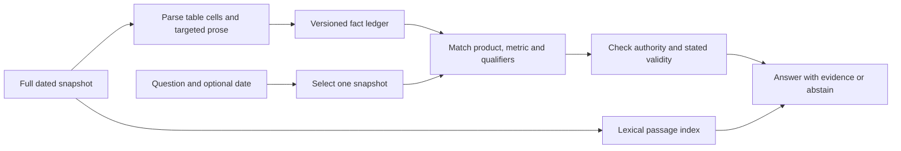

# Knowledge Ledger

**Vedant Thaker**

Suppose a bank's promotion expired on Friday, but its page was crawled again on Monday. A current-rate answer should still treat the offer as expired. Knowledge Ledger keeps the observation date separate from the effective and expiration dates. The [regression tests](tests/test_regressions.py) cover this case alongside two neighboring table cells that mean different things: rate and APY.

Everything runs offline with Python’s standard library. An answer includes the matching facts and source from the chosen snapshot. If two equally authoritative sources disagree, the resolver can return uncertainty. [Resolver](engine.py) · [Implementation notes](NOTES.md)

## How it works



`solution.py` exposes `build()`. The returned object implements `ingest(snapshot)`, `answer(question, as_of=None)`, and `conflicts()`. It uses the organizer's contract classes when available and compatible local dataclasses for standalone tests. This also preserves the harness's exact repeat-check behavior.

The ledger records entity, attribute, qualifiers, value, unit, observation date, snapshot ID, URL, supporting text, effective date, expiration date, source authority, and local context. Table columns are interpreted separately, so dividend rate and APY do not become competing values by accident.

The resolver selects the newest snapshot on or before the requested date. Each snapshot is a full view. A page missing from that view is not carried forward from an earlier crawl. Observation and stated validity remain separate: downloading an old offer again does not renew it.

For rates, an official product table has more authority than a calculator or an old article. Fees require a matching named service. Branch hours retain their branch, weekday, and service channel. Conflicting values at equal authority lead to uncertainty. Values that changed between snapshots are history; disagreement within one view may be a contradiction.

Structured questions use deterministic matching and formatting. Bounded prose rules and lexical retrieval handle other supported topics. The implementation uses only the Python standard library, makes no live website calls, and needs no API keys.

## Run locally

Use Python 3.11. Keep the checkout and organizer kit in adjacent folders; short paths avoid Windows extraction limits:

```text
workspace/
  knowledge-ledger/   # this repository
  organizer-kit/      # the private participant kit
```

From the repository, create a clean environment and install the declared requirements:

```powershell
py -3.11 -m venv .venv
.venv\Scripts\Activate.ps1
python -m pip install -r requirements.txt
python -m unittest discover -s tests -v
python scripts/smoke.py --kit ../organizer-kit
python scripts/benchmark.py --kit ../organizer-kit
```

On macOS or Linux, create the environment with `python3.11 -m venv .venv` and activate it with `source .venv/bin/activate`.

From the organizer kit folder, run the unchanged official evaluator:

```text
python harness/run_eval.py --submission ../knowledge-ledger --eval eval/public_eval.jsonl --out ../knowledge-ledger-results
```

The evaluator unpacks the supplied snapshot ZIPs if needed. It writes detailed local results outside this repository.

## What the checks establish

- Synthetic regressions exercise temporal isolation, tiers, column separation, authority, expiration, abstention, missing pages, weekday hours, and repeated questions using invented pages.
- The smoke test checks `build -> ingest -> answer -> conflicts` with the organizer kit.
- The official public evaluator measures compatibility and performance on the supplied practice questions. These are not hidden-set results.
- The benchmark reports first answers with an initially empty answer cache separately from repeated identical questions.

The public kit does not include hidden conflict gold. Its default scorer also gives no correctness credit to one ordinary practice item with an empty `must_include` list unless the optional model judge is used. That is a measurement limitation, not proof that the response is wrong. Independent regressions remain necessary because matching values alone does not establish correct meaning.

## Limits and data handling

This is a deterministic baseline. Unfamiliar prose and layouts can reduce coverage. Older branch announcements can establish a published historical schedule without proving the hours remain current. Missing named fees and unresolved equal-authority disagreements should produce uncertainty rather than guesses.

The repository contains solution code, invented test fixtures, and run commands. Real snapshots, evaluation data, private interview notes, generated ledgers, and detailed answer logs stay local. Do not upload the organizer kit when sharing or submitting this repository.
